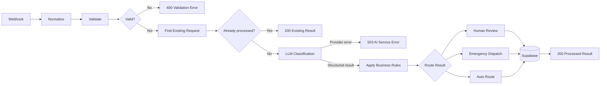

# AI Service Request Triage

An n8n workflow that receives home-service requests through a webhook, validates and deduplicates them, classifies them with an LLM, applies deterministic business rules, routes uncertain cases to human review, and stores the result in Supabase.

The project uses synthetic data and is intended as a portfolio proof of concept for AI integration and business-process automation.

## What the workflow demonstrates

- Webhook-based API intake with normalization and validation
- Idempotent processing by `request_id`
- LLM classification through OpenRouter
- Structured JSON output with a strict schema
- Deterministic priority and SLA rules outside the LLM
- Confidence-based human review
- Emergency escalation
- Supabase persistence
- Explicit validation and AI-provider error responses

## Architecture



The model decides the semantic fields: category, urgency, summary, recommended team, confidence, and classification reason. Priority, SLA, review requirements, and final workflow status are calculated by deterministic n8n rules.

## Routing rules

| Condition | Priority | SLA | Workflow status | Decision mode |
| --- | --- | --- | --- | --- |
| Emergency | P1 | 15 minutes | `emergency_dispatch` | `automated_with_escalation` |
| High urgency | P2 | 60 minutes | `auto_routed` | `automated` |
| Medium urgency | P3 | 240 minutes | `auto_routed` | `automated` |
| Low urgency | P4 | 1,440 minutes | `auto_routed` | `automated` |
| Confidence below 0.80, or category is `general`/`other` | Based on urgency | Based on urgency | `pending_human_review` | `human_assisted` |

Human review takes precedence over emergency dispatch if both conditions are true. This prevents low-confidence model output from triggering an automatic operational action.

## Tech stack

- n8n 2.x
- OpenRouter Chat Model node
- `nvidia/nemotron-3.5-super-vl:free` as the demo model
- Supabase / PostgreSQL
- Docker for local n8n development

The workflow is model-agnostic: the OpenRouter model can be replaced as long as it can reliably produce the required structured output.

## Repository structure

```text
.
├── database/
│   └── schema.sql
├── examples/
│   ├── emergency-request.json
│   ├── human-review-request.json
│   ├── invalid-request.json
│   └── routine-request.json
├── workflow/
│   └── ai-service-request-triage.json
├── .gitignore
└── README.md
```

## Local setup

### 1. Prerequisites

- A running n8n 2.x instance
- A Supabase project
- An OpenRouter account and API key

### 2. Create the database table

Open the Supabase SQL editor and run [`database/schema.sql`](database/schema.sql).

The schema enables Row Level Security but intentionally creates no client policies. Use a server-side Supabase credential in n8n; never expose a service-role key in a browser or commit it to Git.

### 3. Import the workflow

In n8n, choose **Import from File** and select [`workflow/ai-service-request-triage.json`](workflow/ai-service-request-triage.json).

The public export is inactive and contains no credentials, workflow ID, instance ID, or credential IDs.

### 4. Configure credentials

Connect:

1. An OpenRouter credential to **OpenRouter Chat Model**.
2. A Supabase credential to **Find Existing Request**.
3. The same Supabase credential to **Save Triage Result**.

Open each of these nodes once after import and confirm that the model and table selections are valid in your n8n instance.

### 5. Test and publish

For manual execution, click **Listen for test event** and send a request to:

```text
POST http://localhost:5678/webhook-test/service-request-triage
```

After publishing the workflow, use:

```text
POST http://localhost:5678/webhook/service-request-triage
```

## API contract

### Request

```json
{
  "request_id": "demo-emergency-001",
  "customer_name": "Anna Kovalenko",
  "message": "Water is pouring from a burst pipe and rapidly flooding the kitchen floor.",
  "location": "Kyiv",
  "preferred_contact": "phone",
  "source": "portfolio_demo"
}
```

Required fields are `request_id`, `customer_name`, `message`, `location`, and `preferred_contact`. The message must contain at least 20 characters. Supported contact values are `phone`, `email`, and `sms`.

### Example request

```bash
curl -i -X POST http://localhost:5678/webhook/service-request-triage \
  -H 'Content-Type: application/json' \
  --data @examples/emergency-request.json
```

### Successful response

```json
{
  "status": "processed",
  "record_id": "00000000-0000-0000-0000-000000000000",
  "request_id": "demo-emergency-001",
  "category": "plumbing",
  "urgency": "emergency",
  "assigned_team": "Plumbing Team",
  "priority": "P1",
  "sla_minutes": 15,
  "confidence": 0.95,
  "needs_human_review": false,
  "workflow_status": "emergency_dispatch"
}
```

The exact classification and confidence can vary by model and provider.

### Duplicate response

Sending the same `request_id` again returns the stored result with:

```json
{
  "status": "already_processed",
  "duplicate": true
}
```

### Error behavior

| HTTP status | Meaning |
| --- | --- |
| `400` | Input validation failed; the response contains an `errors` array |
| `503` | The request was valid, but the AI provider did not return a usable result |

## Synthetic QA scenarios

The workflow was manually verified with synthetic payloads for:

- missing required fields → `400 validation_error`
- repeated `request_id` → `200 already_processed`, without another model call
- emergency plumbing request → P1 and `emergency_dispatch`
- routine appliance request → P4 and `auto_routed`
- unsupported/general request → `pending_human_review`
- unavailable or invalid model → `503 ai_service_unavailable`

The files in [`examples/`](examples) cover the main branches. Send the same valid file twice to verify deduplication.

## Reliability and safety decisions

- The LLM cannot directly assign the final priority, SLA, or workflow status.
- A structured-output parser constrains model responses.
- Low-confidence and unsupported categories require human review.
- A unique database constraint on `request_id` provides a second idempotency guard.
- Provider failures produce an explicit `503` response instead of a false success.
- Only synthetic data should be sent to free model endpoints unless their data-retention terms are acceptable.

## Production hardening

This repository is a local portfolio POC, not a production deployment. Before exposing the webhook publicly, add:

- webhook authentication or HMAC signature verification
- rate limiting and request-size limits
- secrets management and credential rotation
- Supabase policies appropriate to the deployment model
- centralized logs, alerts, and model-quality monitoring
- a real human-review queue and notification channel
- retry/backoff and a dead-letter path for transient provider errors
- retention and privacy rules for customer messages

The SLA values and operational impact in this demo are simulated business rules; no production time or cost savings are claimed.
